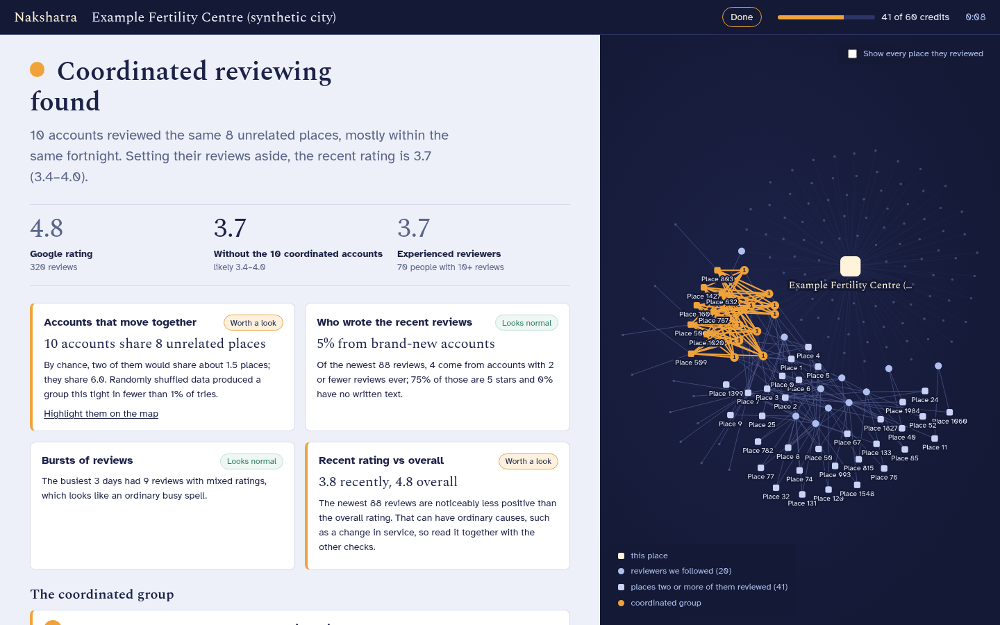
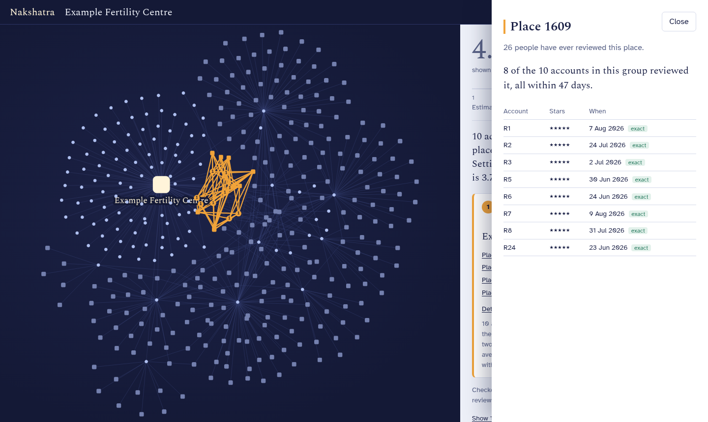
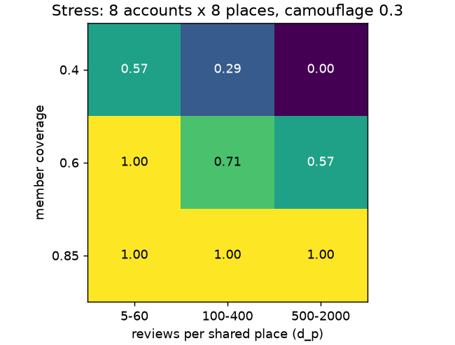
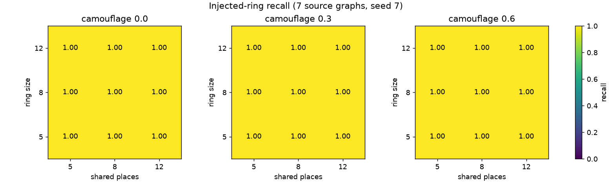
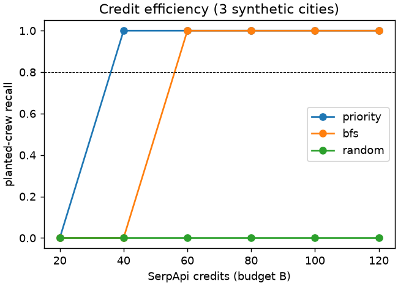
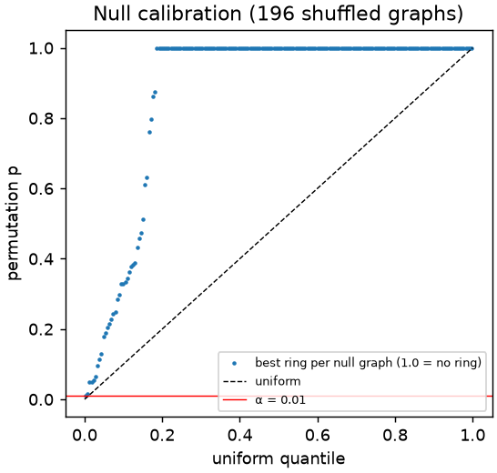
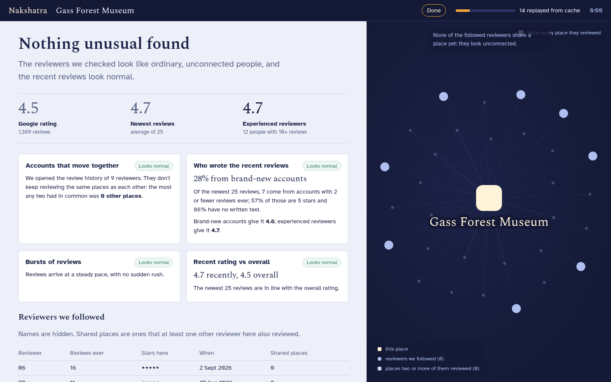

# Nakshatra

**Coordinated review rings are invisible on a place's own reviews. They show up only when you follow the reviewers to their *other* reviews.** Nakshatra does that for one Google Maps place, live, under a fixed SerpApi credit budget. It finds groups of accounts that keep reviewing the same unrelated places together, tests whether chance could explain them, and shows the rating with those accounts set aside.

SerpApi India Hackathon 2026 · Track: Travel & Local Discovery



*Screenshot of the synthetic demo city (clearly labelled), where a crew of 10 accounts was planted. The three real Coimbatore places we could afford to crawl all came back clean; see [Results](#results).*

## Why this needs SerpApi

Google's own Places API has no endpoint for a reviewer's history. SerpApi's **Google Maps Contributor Reviews** engine returns up to 200 of one reviewer's reviews, with each place's ID, type and location, in a single call. That is the reviewer axis this method depends on. Without it there is no ring detection; there is only per-review guesswork.

| Step | SerpApi engine | Parameters | Fields used | Why nothing else works |
| --- | --- | --- | --- | --- |
| Resolve the place | `google_maps` (`type=place`) | `data` built from the Maps `data_id` | `place_results.{data_id, title, type, rating, reviews, gps_coordinates}` | The place's global review count d_p drives everything that follows |
| Neighbourhood baseline | `google_maps` (`type=search`) | `q=<category>`, `ll=@lat,lng,14z` | `local_results[].{rating, reviews}` | Category mean rating that the adjusted rating shrinks toward |
| Read recent reviews | `google_maps_reviews` | `sort_by=newestFirst` / `ratingHigh`, `next_page_token`, `num=20` | `reviews[].{rating, iso_date, user.contributor_id, user.reviews, user.photos, user.local_guide}` | Exact dates and the reviewer IDs to follow. Only `newestFirst` pages feed the rating estimate |
| **Follow reviewers** | **`google_maps_contributor_reviews`** | `contributor_id`, `num=200` | `reviews[].{rating, date, place_info.{data_id, title, type, gps_coordinates}}` | **The reviewer axis. No other API exposes it** |
| Check shared places | `google_maps_reviews` on a "hot" place | `sort_by=newestFirst` | `place_info.reviews`, `reviews[].iso_date`, co-reviewers | Exact dates for timing, the place's popularity, and accounts the first sample missed |

Every call goes through one client: cache first, a budget reservation, a ledger row with SerpApi's `search_id`, retries on 429/5xx, and no key in any log, cache row, fixture or export. A repeat run of the same place costs 0 credits. Our ledger matched SerpApi's account dashboard exactly.

## Try it

You need Python ≥ 3.11 with [uv](https://docs.astral.sh/uv/), and Node ≥ 20.

```bash
make install       # Python + web dependencies
make replay        # judge mode: shipped data/demo.db, no key, 0 credits -> http://127.0.0.1:8000
```

In replay mode, open a run from "Recent investigations" and press **Replay offline**. **Export dossier** downloads the evidence as Markdown or PDF: every group with its accounts' contributor IDs, shared places and dates, the statistics, and the SerpApi search ID behind every call. It is meant for reporting to Google or a consumer authority. The whole investigation streams again from the cache, with the same result. `Example Fertility Centre (synthetic city)` is the planted-crew case. The real Coimbatore clinics and landmarks are the clean cases.

To run on any place live, put a key in `.env` (`cp .env.example .env`, then set `SERPAPI_API_KEY`):

```bash
make demo          # build the UI, serve everything on http://127.0.0.1:8000
make dev           # API with reload on :8000 + Vite on http://localhost:5173
uv run python -m nakshatra.cli "<google maps link or data_id>" --budget 60 [--offline]
make test          # 134 tests; none of them calls SerpApi
make eval          # every evaluation below, from cache and synthetic data (0 credits, ~20 min)
```

The server binds to `127.0.0.1` only. There are no accounts and no hosting.

## How it works



1. **Sample.** Read the newest and highest-rated reviews of the place (about 12 credits at budget 60).
2. **Prior.** Score each reviewer by how likely following them is to pay off: short histories, 5 stars, no photos, burst days. It is a crawl heuristic, never a verdict. Accounts that cannot be in a ring (fewer reviews than a ring needs) are followed last.
3. **Budgeted crawl.** Follow reviewers in priority order through the Contributor Reviews engine. When two followed reviewers share a place, it becomes "hot": its other reviewers move up the queue, and the place is checked for exact dates and its own popularity. After every call the graph is re-mined. The crawl stops when the best group stops growing, or when the budget runs out.
4. **Mine.** Popularity-weighted densest-subgraph peeling, as in FRAUDAR (Hooi et al., KDD 2016), with one adaptation: column weights use each place's **global** review count from Maps (c_p = 1/log(d_p + 5)), not its degree in the crawled slice. Reviews of a temple with 5,000 reviews barely count; reviews of a tile shop with 31 count a lot. That defeats camouflage. The seed place itself is excluded.
5. **Test.** The decision is a **selection-aware permutation test**. Rewire the *crawled* graph 200–500 times, keeping every account's and every place's number of reviews, and rerun the same miner. A group is reported only if fewer than 1% of the rewired graphs produce one as dense. The "expected by chance" figure on screen comes from the same rewired graphs.
6. **Timing.** Relative dates ("2 months ago") become intervals. Real data shows Google rounds them *down*, by calendar month and year. The largest group of members who posted within 14 days of each other comes from an exact sweep line over those intervals. When dates are too coarse, the app says so instead of guessing.
7. **Adjusted rating.** From the `newestFirst` sample only, down-weight reported members' reviews (fully, for dense groups), shrink toward the neighbourhood category mean (κ = 5), and bootstrap a 95% interval with a fixed seed.

No LLM is involved in any of this. Every number traces to SerpApi calls in the ledger and a formula in [Core Algorithm Design](docs/Nakshatra%20Core%20Algorithm%20Design.md).

## Results

All outputs are under [`eval/plots/`](eval/plots/), tagged with the frozen config hash `8dfd7dcb`, and reproducible with `make eval`. Full table: [summary](eval/plots/summary_8dfd7dcb.md).

| Check | Result | Target |
| --- | --- | --- |
| Planted crews of ≥ 8 accounts: recall / precision (spec grid: 5–12 accounts × 5–12 places × camouflage 0–0.6, planted into 4 real crawled graphs + 3 synthetic cities) | **1.00 / 1.00** | ≥ 0.8 / ≥ 0.8 |
| Control places flagged (2 real landmarks + 5 synthetic) | **0 of 7** | ≤ 1 of 10 |
| Null calibration: rewired graphs with p < α | **0.005** (196 graphs) | 0.005–0.02 |
| Credits to reach 0.8 recall: priority / BFS / random (synthetic cities) | **40 / 60 / never** | priority ≤ 50% of BFS: **missed (67%)** |
| Offline replay of the demo | 6.2 s, byte-identical, 0 network calls | < 10 s |

Where it breaks: the stress grid plants 8 × 8 crews with weaker structure.



Detection is reliable when crew members cover most of their shared places (85%), even on popular places. When members cover only 40% of the shared places, and those places are popular (500–2,000 reviews), recall drops to 0. That is the honest edge of the method.

| | |
| --- | --- |
|  |  |
|  |  |

**Real places.** The Free Plan allows 250 searches a month. That covered 2 fertility clinics in Coimbatore (84 and 431 reviews) and 2 landmark controls (Gass Forest Museum, Valankulam Boat House): 84 searches in total, including 8 for field-shape checks and place discovery. All four came back "No coordination detected". We make no claim about any real business. The planted-crew demo is synthetic and labelled as such everywhere it appears.

## Prior art and what is new

Detecting groups of colluding reviewers is well studied (Mukherjee, Liu & Glance, WWW 2012; Hooi et al., KDD 2016). Existing Google Maps tools score reviewers one at a time, and Google's own enforcement is invisible to users. Nakshatra's contribution is practical. It turns group detection into a live investigation of one place, discovering the reviewer graph through SerpApi under a credit budget. It corrects for the biases that discovery introduces, and it reports a consumer-readable adjusted rating with the evidence attached.

To our knowledge, these parts are not in the prior art we found (a literature check, not a survey):

- **budgeted active discovery** of the subgraph through a paid search API, with a stopping rule driven by the running densest-subgraph estimate;
- **global-popularity column weights** to correct the bias of a suspicion-driven crawl;
- **a selection-aware gate**: permuting the *crawled* graph and rerunning the same miner;
- **interval-graph lockstep** on mixed exact and relative timestamps.

Full analysis: [Novelty and Competitive Analysis](docs/Nakshatra%20Novelty%20and%20Competitive%20Analysis.md).

## Limitations and ethics

- **Anomaly, not verdict.** The output says "coordinated" and "unlikely by chance". Real communities, such as a college group, a tour group or a family, can look like rings. Each ring shows its evidence so a person can judge.
- **It catches crews, not lone accounts.** Accounts that each review only one client, or crews smaller than 4 accounts × 3 places, are not detectable. Reviews Google already removed are invisible, so any finding is a lower bound.
- **Sampling.** The rating estimate covers the newest ~100 reviews. Contributor histories are capped at 200 reviews by SerpApi. Unknown place popularity defaults to 50 reviews until a place is checked.
- **Calibration is thin.** The thresholds are frozen from 2 real and 5 synthetic controls, because of the credit limit. The credit-efficiency target was missed on our synthetic cities.
- **Privacy.** No names, photos or profile links are stored. Reviewers appear as R1, R2 and so on, and review text is not shipped. Raw contributor IDs exist only in the local database, for the reporting export.

## Project map

```text
nakshatra/   serp/ (only network code)  graph/ + algo/ (pure)  orchestrator/  report/  api/  store/  cli.py
web/         React + Cytoscape UI       eval/  evaluation harness      tests/  128 tests, fixtures
docs/        PRD, SRS, architecture, API contract (+ openapi.yaml), data model, algorithm design, user flow,
             implementation plan, DECISIONS.md (every deviation from the design docs, with reasons)
```

Built with AI assistance (Claude Code) for implementation; the design documents, decisions log and commit history show how.
